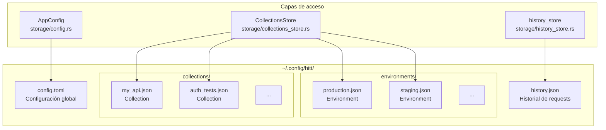

# Almacenamiento y persistencia

> Ver también: [ARCHITECTURE.md](./ARCHITECTURE.md) para la visión general.

hitt persiste su estado en el directorio de configuración: `config.toml`, las colecciones, los environments y el historial (`history.json`).

---

## Diagrama general



---

## AppConfig

**Archivo:** `~/.config/hitt/config.toml`
**Implementación:** `hitt-core/src/storage/config.rs`

### Campos

```rust
pub struct AppConfig {
    pub theme: ThemeName,                   // Default: "catppuccin"
    pub default_environment: Option<String>,
    pub last_environment: Option<String>,   // Environment activo al cerrar (se restaura al iniciar)
    pub history_limit: usize,               // Default: 1000
    pub persist_history: bool,              // Default: true (guarda history.json)
    pub follow_redirects: bool,             // Default: true
    pub verify_ssl: bool,                   // Default: true
    pub timeout_ms: u64,                    // Default: 30_000 (30s)
    pub proxy: Option<String>,
    pub collections_dir: PathBuf,           // Default: ~/.config/hitt/collections
    pub editor: Option<String>,
    pub colors: Option<ThemeOverride>,      // [colors] overrides del tema
    pub borders: Option<BorderOverride>,    // [borders] estilo / ancho del sidebar
}
```

`vim_mode` ya no existe: nunca se leía. Un `config.toml` antiguo que todavía tenga `vim_mode = true` carga sin error (la clave se ignora) y deja de escribirse al guardar.

### Ejemplo de config.toml

```toml
theme = "dracula"
history_limit = 500
persist_history = true
follow_redirects = true
verify_ssl = true
timeout_ms = 30000
```

### Ciclo de vida

1. **`load()`**: Lee `config.toml` desde disco. Si no existe, crea uno con valores por defecto y lo guarda.
2. **`validate()`**: Verifica que `timeout_ms > 0` y `history_limit > 0`.
3. **`save()`**: Serializa a TOML con pretty-printing y escribe al archivo de forma atómica.
4. **CLI overrides**: Los flags `--theme`, `--collection`, `--environment` sobreescriben valores en runtime.

### Modificación en runtime

El comando `:set` cambia la configuración y la guarda en `config.toml`:

```
:set timeout 5000
:set follow_redirects false
:set verify_ssl false
:set history_limit 2000
:set persist_history false
:set theme gruvbox
```

Claves válidas: `timeout`, `follow_redirects`, `verify_ssl`, `history_limit`, `persist_history`, `theme`. Cualquier otra (incluida `vim_mode`) da "Unknown setting".

---

## CollectionsStore

**Directorio:** `~/.config/hitt/collections/`
**Implementación:** `hitt-core/src/storage/collections_store.rs`

### Formato de archivo

Cada colección se guarda como un archivo JSON individual con pretty-printing:

```
~/.config/hitt/collections/
├── my_api.json
├── auth_tests.json
└── payment_service.json
```

### Operaciones

| Método | Descripción |
|--------|-------------|
| `load_all()` | Lee los `*.json` del directorio y deserializa cada uno como `Collection` (los que no parsean se ignoran) |
| `load_collection(path)` | Carga una colección individual desde una ruta |
| `save_collection(collection)` | Guarda colección con nombre sanitizado como filename |
| `delete_collection(collection)` | Elimina el archivo de la colección |

### Environments

Los environments se guardan de forma similar en un subdirectorio:

```
~/.config/hitt/environments/
├── production.json
├── staging.json
└── development.json
```

| Método | Descripción |
|--------|-------------|
| `load_environments()` | Carga todos los archivos `*.json` del directorio de environments |
| `save_environment(env)` | Guarda environment con nombre sanitizado |
| `delete_environment(env)` | Elimina el/los archivo(s) del environment (por id) |

### Sanitización de nombres

Los nombres de archivo se sanitizan reemplazando caracteres no alfanuméricos (excepto `-` y `_`) con `_`:

```
"My API v2.0" → "My_API_v2_0.json"
"test/collection" → "test_collection.json"
```

Cada archivo guarda el `id` de su colección / environment. Si `<Nombre>.json` pertenece a otro id, se usa `<Nombre>_2.json`, `<Nombre>_3.json`…: nunca se sobreescribe el archivo de otro item.

### Nombres únicos

- **Colecciones y environments**: el nombre es único (sin distinguir mayúsculas). `:newcol` / `:newenv` / renombrar rechazan un nombre repetido; `:import` (y `:env-file`) renombran a "Nombre (2)", "Nombre (3)"… Si el nombre ya termina en " (N)" se reemplaza el número en lugar de apilarlo: importar otra vez "API (2)" da "API (3)", nunca "API (2) (2)" ni "API (1)".
- **Requests**: únicos dentro de su colección (sin distinguir mayúsculas). `hitt create`, renombrar en el sidebar, `F2` y `:rename` (si el tab es de una colección) rechazan un nombre repetido; `a` en el sidebar crea "New Request", "New Request 2", …
- **Chains**: únicas dentro de su colección. `:newchain` y `hitt chain create` rechazan un nombre repetido; importar una chain (`:import`, `:importchain`, `hitt chain import`) la renombra a "Flow (2)"…

---

## Historial (`history.json`)

**Archivo:** `history.json`, junto al directorio de colecciones (`~/.config/hitt/history.json` por defecto)
**Implementación:** `hitt-core/src/storage/history_store.rs` (archivo) + `hitt-core/src/core/history.rs` (`HistoryStore` en memoria)

### Modelo

```rust
pub struct HistoryEntry {
    pub id: Uuid,
    pub method: HttpMethod,
    pub url: String,
    pub status: Option<u16>,
    pub duration_ms: Option<u64>,
    pub size_bytes: Option<usize>,
    pub timestamp: DateTime<Utc>,
    pub collection_id: Option<Uuid>,
    pub request_id: Option<Uuid>,
    pub response_body: Option<String>,
    pub request_body: Option<String>,
    pub request: Option<Request>,            // Snapshot sin resolver (para reabrir / :replay)
    pub response_headers: Vec<KeyValuePair>,
}
```

### Almacenamiento

- **Formato**: un array JSON de `HistoryEntry`, el más reciente primero; se escribe de forma atómica.
- **Cuándo**: después de cada request completado si `persist_history = true` (default). `:clearhistory` vacía el historial y borra el archivo.
- **Límite**: `history_limit` (default: 1000); `:set history_limit <n>` lo aplica al momento (en memoria y en disco).
- **Bodies grandes**: los bodies de response de más de 256 KB (`MAX_PERSISTED_HISTORY_BODY`) no se escriben al archivo (se mantienen en memoria durante la sesión).
- **`persist_history`**: `:set persist_history false` deja el archivo como está y no lo vuelve a escribir; `:set persist_history true` mezcla el historial de la sesión con el guardado (sin duplicados, respetando el límite) y lo escribe.

### Operaciones

| Función | Descripción |
|--------|-------------|
| `history_file(collections_dir)` | Ruta de `history.json` |
| `load_history(path, limit)` | Carga hasta `limit` entries (archivo ausente = historial vacío) |
| `save_history(path, entries)` | Escribe el archivo (sin los bodies grandes) |
| `clear_history(path)` | Borra el archivo |

### HistoryStore (en memoria)

```rust
pub struct HistoryStore {
    entries: Vec<HistoryEntry>,
    max_entries: usize,
}
```

| Método | Descripción |
|--------|-------------|
| `add(entry)` | Agrega al inicio, trunca si excede `max_entries` |
| `entries()` | Retorna slice de entries |
| `search(query)` | Búsqueda por substring en URL y método |
| `get(id)` | Busca por UUID |
| `clear()` | Limpia todo |

---

## Rutas del filesystem

```rust
// Configuración
fn config_dir() -> PathBuf {
    dirs::config_dir().join("hitt")     // ~/.config/hitt/
}

fn config_file() -> PathBuf {
    config_dir().join("config.toml")    // ~/.config/hitt/config.toml
}

// Colecciones
collections_dir = config_dir().join("collections")
environments_dir = collections_dir.parent().join("environments")

// Historial
history_file = collections_dir.parent().join("history.json")
```

### Plataformas

| Plataforma | config_dir |
|-----------|-----------|
| Linux | `~/.config/hitt/` |
| macOS | `~/Library/Application Support/hitt/` |
| Windows | `%APPDATA%\hitt\` |
