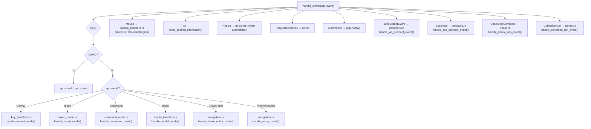

# Sistema de eventos

> Ver también: [ARCHITECTURE.md](./ARCHITECTURE.md) para el modelo de estado `App`.

## AppEvent enum

Todos los eventos del sistema fluyen a través de `AppEvent`. El `EventHandler` los produce y `handle_event()` los despacha.

```rust
pub enum AppEvent {
    Key(KeyEvent),                                    // Teclado (crossterm)
    Mouse(MouseEvent),                                // Mouse (crossterm)
    Tick,                                             // Timer periódico (100ms)
    Resize(u16, u16),                                 // Cambio de tamaño de ventana
    RequestComplete,                                  // Request HTTP completada
    Notification(String, NotificationKind),            // Notificación UI
    WebSocketEvent { session_id: Uuid, event: WsEventData },   // Evento WS
    SseEvent { session_id: Uuid, event: SseEventData },        // Evento SSE
    ChainStepComplete { run_id: Uuid, event: ChainStepEvent }, // Paso de chain (eventos de runs cancelados se ignoran)
    CollectionRun { run_id: Uuid, event: CollectionRunEvent }, // Progreso del collection runner (`:run`)
    Paste(String),                                    // Bracketed paste (texto pegado completo)
}
```

### Subtipos de eventos de protocolo

```rust
enum WsEventData {
    Connected,
    Disconnected,
    MessageReceived(WsMessage),
    Error(String),
}

enum SseEventData {
    Connected,
    Disconnected,
    Event(SseEvent),
    Error(String),
}

enum ChainStepEvent {
    Running,
    Success,
    Failed,
    Skipped,
    Complete,
}
```

---

## EventHandler

Hilo OS dedicado que captura eventos de `crossterm` y los envía por un canal `mpsc` async.

```rust
pub struct EventHandler {
    rx: mpsc::UnboundedReceiver<AppEvent>,
    tx: mpsc::UnboundedSender<AppEvent>,
}
```

### Funcionamiento

1. **Hilo OS dedicado**: Usa `std::thread::spawn` para no bloquear el runtime de tokio
2. **Polling**: `crossterm::event::poll(tick_rate)` con intervalo de `TUI_TICK_RATE_MS` (100ms)
3. **Filtrado**: Descarta eventos de mouse ruidosos (`MouseEventKind::Moved`, `Drag`) para evitar re-renders innecesarios
4. **Canal async**: Los eventos se envían por `mpsc::UnboundedSender<AppEvent>` al loop principal
5. **Bracketed paste**: `main.rs` activa `EnableBracketedPaste`; `Event::Paste` llega como `AppEvent::Paste` y `editors::handle_paste()` lo inserta en el campo activo (formulario, editor de body, URL, input WS o command mode)

### Uso del sender

El sender se clona y se comparte con las bridge tasks de WebSocket/SSE para que puedan inyectar eventos al loop principal:

```rust
app.event_sender = Some(events.sender());
// Las bridge tasks usan event_sender.send(AppEvent::WebSocketEvent { ... })
```

---

## Dispatch por modo



---

## Módulos de handlers

| Archivo | Responsabilidad | Funciones principales |
|---------|----------------|----------------------|
| `key_handlers.rs` | Normal mode: navegación, acciones globales, atajos vim | `handle_normal_mode()` — 515 líneas, despacha según `FocusArea` y tecla |
| `insert_mode.rs` | Insert mode: edición de texto en URL bar y WS message; delega a los editores si hay uno abierto | `enter_insert_mode()`, `handle_insert_mode()` |
| `editors.rs` | Editores de params / headers / body / auth / assertions y modal de variables | `handle_request_editor_key()`, `begin_request_edit()`, `handle_request_editor_insert()`, `handle_env_editor_modal()`, `handle_paste()` |
| `command_mode.rs` | Command mode: input y ejecución de comandos `:` | `handle_command_mode()` — delegación a `execute_command()` |
| `commands.rs` | Paleta de comandos: 30+ comandos disponibles | `execute_command()` — parsing de comando y argumentos, 730 líneas |
| `modal_handlers.rs` | Manejo de modales: search, help, import, export, rename | `handle_modal_mode()` → despacho a handler específico por `ModalKind` |
| `mouse_handlers.rs` | Eventos de mouse: click y scroll con hit-testing. Un click fuera del input que se está editando (URL, editor del body, input de WS) sale de insert mode antes de aplicar el click (`abandon_editing()`), también en zonas sin acción (barra de estado, espacio vacío de las barras de tabs) | `handle_mouse_click()`, `handle_mouse_scroll()`, `hit_test()` |
| `navigation.rs` | Navegación direccional dentro de paneles | `handle_nav_down/up/left/right()`, chain editor mode, proxy mode |
| `sidebar.rs` | Estado del sidebar: expandir/colapsar, selección | `build_sidebar_items()`, `handle_sidebar_action()`, `flatten_sidebar_items()` |
| `chain.rs` | Ejecución de request chains | `start_chain_execution()`, `run_chain_task()`, `handle_chain_step_event()` |
| `runner.rs` | Collection runner: `:run`, `:runexport`, `R` en el sidebar y el modal `ModalKind::Runner` | `run_command()`, `start_collection_run()`, `handle_collection_run_event()`, `handle_runner_modal()`, `export_run_report()` |
| `protocols.rs` | Eventos de WebSocket y SSE | `handle_ws_protocol_event()`, `handle_sse_protocol_event()`, `cycle_protocol_method()` |
| `environments.rs` | Renombrar / eliminar environments (`:renameenv`, `:delenv`, `R` / `D` en el modal) | `rename_environment()`, `request_delete_environment()`, `delete_environment()` |
| `persistence.rs` | Guardar colecciones y environments a disco | `save_all_collections()`, `save_environment()`, `remove_request_from_collection()` |
| `import_export.rs` | Auto-detección y ejecución de import/export | `execute_import()`, `execute_export()`, `execute_import_chain()` |

---

## Normal mode — Keybindings principales

### Navegación

| Tecla | Acción |
|-------|--------|
| `j` / `↓` | Abajo (contexto: scroll, selección, navegación) |
| `k` / `↑` | Arriba |
| `h` / `←` | Izquierda (tabs; sidebar: colapsar o ir al padre) |
| `l` / `→` | Derecha (tabs; sidebar: expandir o abrir la request, nunca colapsa) |
| `J`, `Ctrl+D` | Half-page scroll down (15 líneas; también en el modal de ayuda). En el sidebar mueve la selección media lista visible |
| `K`, `Ctrl+U` | Half-page scroll up (15 líneas; en el sidebar, media lista visible) |
| `g` | Ir al inicio (en el sidebar: primer elemento) |
| `G` | Ir al final (en el sidebar: último elemento) |
| `Tab` | Ciclar foco adelante. Panel mode, en orden de pantalla: URL → tabs de request → body de request → tabs de response → body de response → sidebar |
| `Shift+Tab` | Ciclar foco atrás (orden inverso) |
| `Alt+h/j/k/l` | Navegación directa entre paneles (también en Panel mode) |
| `Enter` | Global→Panel mode; en Panel: acción contextual (en el área de request: editar) |
| `Esc`, `q` | Panel→Global mode |

### Acciones

| Tecla | Acción |
|-------|--------|
| `Ctrl+R` | Enviar request |
| `i` | Entrar en insert mode |
| `:` | Entrar en command mode |
| `/`, `p`, `Ctrl+P` | Búsqueda fuzzy de requests (sin distinguir mayúsculas). En el modal: `↑`/`↓`, `Tab`/`Shift+Tab`, `Ctrl+N`/`Ctrl+P` mueven la selección; `Enter` abre la seleccionada (si ya está abierta en un tab, cambia a ese tab) |
| `/` (Response Body) | Filtro de la response (por tab); `n` / `N` siguiente / anterior coincidencia, `Esc` limpia |
| `?` | Abrir / cerrar ayuda (siempre abre arriba) |
| `e`, `Ctrl+E` | Ciclar environments: env 1 → … → env N → No Env → env 1 |
| `E` | Editor de variables del environment activo |
| `t`, `Ctrl+N` | Nuevo tab |
| `w` | Cerrar tab (pide confirmación si tiene cambios). En el último tab: lo reinicia a un request en blanco |
| `n` / `b` | Siguiente / anterior tab |
| `Alt+1-9` | Tab directo por número (todos los cambios de tab reinician el scroll de request / response) |
| `s`, `Ctrl+S` | Guardar request |
| `y` | Copiar response |
| `d` | Diff selector |
| `m` | Ciclar método HTTP / protocolo |
| `1-5` | Cambiar sub-tab de request/response |
| `q` | Quit; en el Response Body de un WS / SSE conectado (o conectando): desconectar |
| `Ctrl+O` | Import modal (Ctrl+I llega como Tab en la mayoría de terminales) |
| `Ctrl+X` | Export modal |
| `x` | En el sidebar: eliminar la request (Collections) o la chain (Chains), siempre con confirmación |
| `r` | Renombrar (en sidebar). Una request no puede tomar el nombre de otra de su colección (sin distinguir mayúsculas) |
| `R` | Ejecutar la colección / carpeta seleccionada con el collection runner (en sidebar, sección Collections) |
| `a` | Response Body de un SSE: alternar Events / Stream. Sidebar: agregar request a la colección seleccionada ("New Request", "New Request 2", …) |
| `F2` | Renombrar tab (si el tab es de una colección, rechaza el nombre de otra request de esa colección) |

### Sidebar: sección History

Cada entrada muestra método + URL y, en una segunda línea, el status (con color), la duración y la antigüedad (`now`, `42s`, `5m`, `3h`, `2d`, `6w`).

| Tecla | Acción |
|-------|--------|
| `Enter` | Reabrir la entrada en un tab nuevo (snapshot del request: headers, params, body, auth, assertions) con la response guardada, sin enviar. Entradas antiguas sin snapshot: request de la colección (por `request_id`) o método + URL |
| `r`, `Ctrl+R` | Replay: reabrir en un tab nuevo y enviar al momento (las variables se resuelven con el environment actual) |

El historial respeta `history_limit` y se guarda en `history.json` (junto al directorio de colecciones) en cada request si `persist_history = true` (por defecto). Los bodies de response de más de 256 KB no se escriben al archivo. `:set persist_history false` no toca el archivo; `:set persist_history true` mezcla el historial de la sesión con el guardado (sin duplicados, respetando `history_limit`) antes de escribir.

### Sidebar: sección Chains

| Tecla | Acción |
|-------|--------|
| `Enter` / `l` | Ejecutar la chain. Cada paso se marca *Running* al empezar. `Esc` / `q` en el chain runner: si corre, la detiene (los pasos pendientes quedan *Cancelled*); si no, cierra |
| `x` | Eliminar la chain (pide confirmación, `ConfirmAction::DeleteChain`) |

Cada run de chain tiene un `run_id` y un abort handle (`App::chain_run_id`, `App::chain_abort`): iniciar otro run o cancelar aborta la tarea anterior y sus eventos se descartan.

La barra de estado muestra atajos según el modo (insert, command, cada modal, runners) y, en normal mode, según el panel y la sección del sidebar.

---

## Editores del request

El estado vive en `editor.rs` (`App::editor`), las teclas en `event/editors.rs` y el render en `ui/widgets/request_editors.rs`.

Las teclas de tabla solo aplican con foco **Panel** en el área de request (`FocusArea::RequestBody`) y solo en el sub-tab correspondiente; si el editor no usa la tecla, se aplica el binding global (p. ej. `t` = nuevo tab en Params/Headers, `d` = diff en un body de texto). `i` abre el editor también desde Global mode. `Ctrl+R` sigue enviando la request (`Enter` en el área de request ahora edita).

Mientras un campo está en edición (insert mode) **todas** las teclas imprimibles van al campo; ningún atajo se dispara.

### Tablas key/value (Params, Headers, body form-urlencoded / form-data, variables)

| Tecla | Acción |
|-------|--------|
| `j` / `k`, `↓` / `↑` | Seleccionar fila |
| `g` / `G` | Primera / última fila |
| `a` | Agregar fila (abre la edición; `Esc` la descarta) |
| `i` / `Enter` | Editar la fila seleccionada (agrega una si la tabla está vacía) |
| `x` / `d` / `Delete` | Eliminar fila |
| `Space` | Activar / desactivar fila (las desactivadas se ven atenuadas) |

Los params activos se agregan a la URL al enviar (`helpers::append_query_params` deduplica).

### Formularios de edición (filas, auth, assertions)

| Tecla | Acción |
|-------|--------|
| `Tab` / `↓` | Siguiente campo (key ↔ value en tablas) |
| `Shift+Tab` / `↑` | Campo anterior |
| `←` / `→` / `Space` | Cambiar opción en campos de selección |
| `←` / `→`, `Home` / `End`, `Ctrl+A` / `Ctrl+E` | Mover cursor |
| `Backspace` / `Delete` / `Ctrl+U` | Borrar carácter / siguiente / hasta el inicio |
| `Enter` | Guardar (errores de validación se muestran sin cerrar) |
| `Esc` | Cancelar |

### Body

| Tecla | Acción |
|-------|--------|
| `t` | Ciclar tipo: none → json → raw → form-urlencoded → form-data → graphql (el texto / las filas se conservan entre tipos compatibles) |
| `i` / `Enter` | Editor multilínea (json, raw, query GraphQL) o tabla (form) |
| `I` | GraphQL: editar variables |
| `f` | JSON: formatear (conserva el orden de las keys); JSON inválido solo muestra un aviso |
| `c` | Raw: editar Content-Type |
| `Esc` | Editor multilínea: terminar (guarda el texto) |

En el editor multilínea (`tui-textarea`) `Enter` inserta salto de línea, `Tab` indenta y se puede pegar texto. El `Content-Type` lo pone `client.rs::apply_body` (json, raw, graphql; en form-data reqwest pone `multipart/form-data` con el boundary); el editor no agrega headers. En form-data un valor que empieza con `@` (`@./foto.png`) se envía como archivo leído de disco (error claro si no existe); las filas desactivadas no se envían.

### Auth

| Tecla | Acción |
|-------|--------|
| `t` | Ciclar tipo: none → bearer → basic → API key → OAuth 2.0 → inherit |
| `j` / `k` | Seleccionar campo |
| `i` / `Enter` | Editar los campos (formulario; API key: header / query, OAuth2: grant type) |
| `v` | Mostrar / ocultar secretos (por defecto se ven solo los últimos 4 caracteres) |

### Assertions

Misma tabla que arriba (`a`, `i`/`Enter`, `x`/`d`, `Space`). El formulario tiene un selector **Kind** (status equals / range, JSONPath exists / equals / type / contains, body contains, header exists / equals, response time, size, JSON schema) y los campos del tipo elegido.

### Modal de variables (`E`, `:envedit`, `:colvars`)

| Tecla | Acción |
|-------|--------|
| `a` / `i` / `Enter` / `x` / `Space` | Igual que las tablas key/value |
| `s` | Marcar / desmarcar variable como secreta |
| `v` | Mostrar / ocultar secretos |
| `e` | Siguiente environment |
| `n` | Crear environment (pide el nombre) |
| `R` | Renombrar el environment activo (borra el archivo viejo y guarda con el nombre nuevo) |
| `D` | Eliminar el environment activo (pide confirmación, `ConfirmAction::DeleteEnvironment`) |
| `c` | Alternar entre variables del environment y de la colección del tab |
| `Esc` / `q` | Cerrar (o cancelar la edición en curso) |

Los cambios se guardan al momento con `save_environment()` / `save_all_collections()`. Los environments cargados desde archivos `.env` (`--env`, `:env-file`) se registran en `App::session_env_ids`: se pueden editar pero no se guardan (el título del modal lo indica).

El environment activo se recuerda entre sesiones: cada cambio (`e` / `Ctrl+E`, click en el selector, `:env`, `:newenv`, `:dupenv`, `n` en el modal, activación al importar, rename / delete) llama a `App::remember_active_env()`, que guarda `last_environment` en `config.toml` (solo ese campo). Al arrancar, `App::restore_last_environment()` lo activa si existe (si no, usa `default_environment`). Los environments session-only no se recuerdan.

---

## Paleta de comandos

Accesible con `:` en normal mode. Los comandos disponibles:

### Generales

| Comando | Argumentos | Descripción |
|---------|-----------|-------------|
| `:q`, `:quit` | — | Salir de la aplicación |
| `:help` | — | Mostrar modal de ayuda |
| `:theme` | `[nombre]` | Cambiar tema (catppuccin, dracula, everforest, gruvbox, kanagawa, nord, one-dark, rose-pine, solarized-dark, tokyo-night); sin nombre abre el selector |
| `:set` | `<key> <value>` | Configurar y guardar en `config.toml`: `timeout`, `follow_redirects`, `verify_ssl`, `history_limit`, `persist_history`, `theme` (`vim_mode` ya no existe: "Unknown setting") |

En command mode: `Backspace` sobre la línea vacía sale (como vim); `:` + `Enter` no hace nada; `↑` / `↓` recorren los comandos anteriores.

### Requests y colecciones

| Comando | Argumentos | Descripción |
|---------|-----------|-------------|
| `:save` | — | Guardar request actual |
| `:rename` | `<nombre>` | Renombrar request actual (si el tab es de una colección, el nombre debe ser único en ella, sin distinguir mayúsculas) |
| `:delreq` | — | Eliminar request seleccionada (pide confirmación) |
| `:newcol` | `<nombre>` | Crear nueva colección (rechaza nombres existentes) |
| `:delcol` | `[nombre]` | Eliminar colección (pide confirmación) |
| `:curl` | — | Copiar request como cURL al clipboard (con la auth heredada de carpeta / colección) |
| `:paste-curl` | — | Importar cURL del clipboard (error si el clipboard no se puede leer o no contiene un comando curl) |

Renombrar una colección a un nombre existente se rechaza; renombrar una request actualiza el título de sus tabs abiertos.

### Environments y variables

| Comando | Argumentos | Descripción |
|---------|-----------|-------------|
| `:env` | `<nombre\|none>` | Cambiar environment activo (`none` = No Env); sin argumento muestra el uso y la lista |
| `:newenv` | `<nombre>` | Crear nuevo environment (rechaza nombres existentes: no sobrescribe archivos) |
| `:dupenv` | `[nombre]` | Duplicar environment activo (rechaza nombres existentes) |
| `:renameenv` | `<nombre>` | Renombrar environment activo |
| `:delenv` | `[nombre]` | Eliminar environment (el activo si se omite; pide confirmación) |
| `:env-file` | `<ruta>` | Cargar archivo .env (session-only) y activarlo; con nombre repetido se renombra a ".env (2)", igual que `:import` |
| `:addvar` | `<key> <value>` | Agregar variable a la colección (si la key existe, actualiza el valor) |
| `:envedit` | — | Abrir el editor de variables del environment activo |
| `:colvars` | — | Abrir el editor de variables de la colección del tab |

### Import / Export

| Comando | Argumentos | Descripción |
|---------|-----------|-------------|
| `:import` | `[ruta]` | Importar por nombre de archivo: `.json` (Postman colección / environment), `.har`, `.yaml`/`.yml` (chain si tiene `steps`, si no OpenAPI), `.env` / `*.env` / `.env.*` (dotenv, session-only), `.curl` / `.sh` / `.txt` / sin extensión (cURL). Otras extensiones: "Unsupported file type". Colecciones / environments / chains con nombre repetido se renombran a "Nombre (2)"; si ya terminan en " (N)" se usa el siguiente número libre ("API (2)" → "API (3)", nunca "(1)"). Sin ruta (`:import` solo) abre el modal de import, igual que `Ctrl+O` |
| `:export` | `[ruta] [colección]` | Sin ruta abre el modal de export. `.json` (Postman) y `.md` (docs) exportan la colección indicada (sin distinguir mayúsculas), si no la seleccionada en el sidebar (si tiene foco), si no la del tab activo; sin ninguna: "No collection selected". Una ruta con espacios funciona si termina en una extensión conocida. Otros formatos: `.sh` / `.curl` / `.txt` (cURL con auth heredada), `.env` (líneas `KEY=value` del environment activo; valores con espacios o caracteres especiales entre comillas). Un directorio da "Path is a directory" |
| `:docs` | — | Exportar documentación Markdown |

### Protocolos

| Comando | Argumentos | Descripción |
|---------|-----------|-------------|
| `:ws` | `<url>` | Conectar WebSocket |
| `:ws-disconnect` | — | Desconectar WebSocket ("Not connected" si no hay conexión) |
| `:sse` | `<url>` | Conectar SSE |
| `:sse-disconnect` | — | Desconectar SSE ("Not connected" si no hay conexión) |

### Chains

| Comando | Argumentos | Descripción |
|---------|-----------|-------------|
| `:chain` | `<nombre>` | Ejecutar chain (sin distinguir mayúsculas; si el nombre existe en varias colecciones: la chain activa, luego la de la colección del tab, luego la primera) |
| `:newchain` | `<nombre>` | Crear nueva chain en la colección del tab (o la primera) y hacerla la chain activa. Rechaza un nombre que ya exista en esa colección (sin distinguir mayúsculas) |
| `:addstep` | `<request_name> [--chain <nombre>]` | Agregar step a la chain activa (o a `--chain`); solo requests de la colección de la chain |
| `:importchain` | `<ruta>` | Importar chain desde YAML (con nombre repetido en la colección se renombra a "Nombre (2)") |

### Testing

| Comando | Argumentos | Descripción |
|---------|-----------|-------------|
| `:loadtest` | `<total> <concurrency>` | Ejecutar prueba de carga |
| `:diff` | — | Abrir selector de diff |
| `:run` | `[colección] [carpeta] [--bail]` | Collection runner: envía todas las requests en orden y ejecuta sus assertions. Sin colección usa la selección del sidebar (si tiene foco), la colección del tab activo o la selección del sidebar. Nombres con espacios entre comillas |
| `:runexport` | `<ruta.json\|ruta.xml\|ruta.txt>` | Exportar el reporte del último run (JSON, JUnit XML o texto) |

#### Modal del collection runner (`ModalKind::Runner`)

El run corre en una tarea tokio y envía `AppEvent::CollectionRun { run_id, event }` (`CollectionRunEvent::Progress(RunEvent)` / `Finished(RunSummary)` / `Failed`); los eventos de un run cancelado se ignoran por `run_id`. Estado en `app.runner` (`ui/widgets/runner.rs`). Usa el environment activo (sobrescribe variables de colección) y la auth heredada de carpeta / colección. Las requests WS / SSE / gRPC se reportan como *skipped*.

| Tecla | Acción |
|-------|--------|
| `j` / `k`, `↓` / `↑`, `g` / `G` | Mover la selección (al terminar se posiciona en el primer fallo) |
| `Enter` | Abrir la request seleccionada en un tab nuevo con su response y resultados de assertions |
| `x` | Exportar el reporte (pide la ruta; `.json`, `.xml` JUnit o `.txt`) |
| `Esc` / `q` | Mientras corre: cancelar (conserva los resultados parciales). Terminado: cerrar (el último run sigue disponible para `:runexport`) |

### Otros

| Comando | Argumentos | Descripción |
|---------|-----------|-------------|
| `:proxy` | — | Proxy inspector (todavía no disponible: muestra un aviso) |
| `:clearhistory` | — | Limpiar historial de requests (también borra `history.json`) |
| `:replay` | `[n]` | Reabrir y enviar la entrada `n` del historial (1 = la más reciente; por defecto la seleccionada en History, o la más reciente). Con el historial vacío: "History is empty" |
